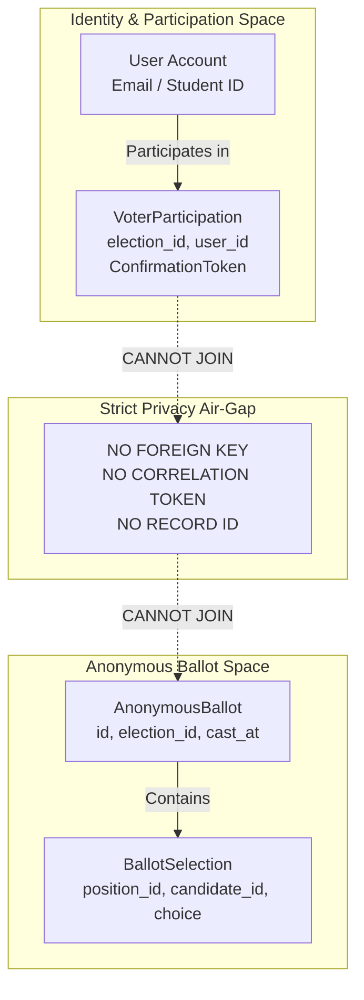

# Feature: Campus Voting Domain & Privacy Decoupling Architecture

## Overview
This document specifies the core domain models, lifecycle states, database constraints, and privacy architecture implemented in `apps/api/internal/models/` and `apps/api/internal/database/` for the MMU Campus E-Voting System.

## 1. Domain Entities

| Entity | Go Model | Database Table | Key Attributes & Constraints |
|---|---|---|---|
| **Election** | `models.Election` | `elections` | Lifecycle: `DRAFT`, `REGISTRATION`, `SCHEDULED`, `OPEN`, `CLOSED`, `RESULTS_UNDER_REVIEW`, `FINALIZED`, `ARCHIVED`, `CANCELLED`. Schedule: `StartsAt`, `EndsAt` (UTC stored, displayed in EAT). Results policy: `LIVE`, `AFTER_CLOSE`, `CERTIFIED_ONLY`. Allowed domains: `@std.must.ac.ug,@must.ac.ug`. |
| **Position** | `models.Position` | `positions` | Contest types: `SINGLE_CHOICE`, `MULTI_CHOICE`, `YES_NO`, `REFERENDUM`. Enforces `MinSelections`, `MaxSelections`, `Seats`, `AllowBlank`, `DisplayOrder`. |
| **Candidate** | `models.Candidate` | `candidates` | `FullName`, `Manifesto`, `Bio`, `BallotNumber`, `PhotoURL`, `ApprovalStatus` (`PENDING`, `APPROVED`, `REJECTED`, `WITHDRAWN`). |
| **Election Roster** | `models.ElectionRoster` | `election_rosters` | Institutional voter list. Unique indexes: `(election_id, email)` and `(election_id, student_number)`. Attributes: `Faculty`, `Department`, `Programme`, `StudyYear`, `Status` (`ELIGIBLE`, `INELIGIBLE`, `GRADUATED`, `SUSPENDED`). |
| **Voter Participation** | `models.VoterParticipation` | `voter_participations` | Unique constraint: `(election_id, user_id)`. Random `ConfirmationToken` generated for voter receipt. Strictly separated from ballot contents. |
| **Anonymous Ballot** | `models.AnonymousBallot` | `anonymous_ballots` | Anonymous container holding accepted choices. Contains `id`, `election_id`, `status` (`VALID`, `SPOILED`), `cast_at`. Zero foreign keys or links to voter identity. |
| **Ballot Selection** | `models.BallotSelection` | `ballot_selections` | Individual position choice: `ballot_id`, `position_id`, `candidate_id`, `choice` (`YES`, `NO`, `ABSTAIN`, or candidate ID). |
| **Election Tally** | `models.ElectionTally` | `election_tallies` | Snapshot of calculated results per position/candidate: `votes`, `valid_votes_total`, `percentage`, `turnout_percentage`, `is_winner`, `is_tie`. |
| **Election Audit Log** | `models.ElectionAuditLog` | `election_audit_logs` | Immutable audit trail for administrative actions (`ELECTION_CREATED`, `ROSTER_IMPORTED`, `ELECTION_OPENED`, `ELECTION_CLOSED`, `RESULTS_CERTIFIED`, `RECOUNT_TRIGGERED`). Never logs secret ballots. |

---

## 2. Privacy Decoupling Architecture (FR-PRIV-01, FR-PRIV-02, FR-PRIV-03)

In accordance with Section 3.7 of `SRS.md`, ballot secrecy is guaranteed through strict physical and logical decoupling:



### Verification via Structural Reflection
The privacy boundary is enforced through unit tests in `apps/api/internal/models/voting_test.go`:
- `TestBallotPrivacyDecoupling` inspects the Go struct definitions of `AnonymousBallot` and `BallotSelection` using reflection, asserting that neither struct contains `UserID`, `VoterID`, `Email`, `StudentNumber`, `IPAddress`, or session tokens.
- Conversely, `VoterParticipation` is checked to ensure it contains no `BallotID`, `CandidateID`, `Choice`, or selection fields.

---

## 3. Duplicate Prevention & Database Constraints (FR-VOTE-04, FR-VOTE-06)

One accepted ballot per voter per election is enforced through a database unique constraint:
```sql
CREATE UNIQUE INDEX idx_participation_election_user ON voter_participations (election_id, user_id);
```
- A retry, concurrent submission, or double-click triggers a unique key constraint violation in the database transaction, rolling back the operation cleanly and returning HTTP 409 Conflict without corrupting tally tables or double-counting votes.
- Verified in `TestDuplicateVotingConstraint`: concurrent/duplicate participation attempts are rejected at the database level.

---

## 4. Full Monorepo Type Synchronization

Go structs in `apps/api/internal/models/` are synchronized directly to TypeScript interfaces and Zod schemas in `packages/shared/`:
- `packages/shared/types/election.ts` & `packages/shared/schemas/election.ts`
- `packages/shared/types/anonymous-ballot.ts` & `packages/shared/schemas/anonymous-ballot.ts`
- `packages/shared/types/ballot-selection.ts` & `packages/shared/schemas/ballot-selection.ts`
- `packages/shared/types/candidate.ts` & `packages/shared/schemas/candidate.ts`
- `packages/shared/types/position.ts` & `packages/shared/schemas/position.ts`
- `packages/shared/types/voter-participation.ts` & `packages/shared/schemas/voter-participation.ts`
- `packages/shared/types/election-roster.ts` & `packages/shared/schemas/election-roster.ts`
- `packages/shared/types/election-tally.ts` & `packages/shared/schemas/election-tally.ts`
- `packages/shared/types/election-audit-log.ts` & `packages/shared/schemas/election-audit-log.ts`

---

## 5. Seed Data for Local Development

`apps/api/internal/database/elections_seeder.go` creates realistic demo scenarios for MMU. Demo data is created **only when `APP_ENV=development`**; with any other value the seeder logs a skip and writes nothing.

1. **Accounts (synthetic demo users only):**
   - `ivan.mugisha@std.must.ac.ug` (Student Voter, password `admin123`)
   - `doreen.kemigisa@std.must.ac.ug` (Student Voter, password `admin123`)

   No administrator is seeded and there is no default admin password. Create the first administrator once with `go run ./cmd/bootstrap` and `BOOTSTRAP_ADMIN_EMAIL` / `BOOTSTRAP_ADMIN_PASSWORD`. See [`../auth.md`](../auth.md).
2. **Guild Representative Council Election 2026/2027:**
   - Status: `OPEN`
   - Positions: Guild President, Vice Guild President, Referendum on Article 42
   - Candidates: 3 Guild President candidates with detailed manifestos, 2 Vice President candidates, 2 Referendum options (YES/NO)
   - Eligibility Roster: Pre-populated with student numbers (`22/U/1001/PS`, `22/U/1002/PS`)
3. **Faculty of Science & Technology Election:**
   - Status: `SCHEDULED` (opens in 72 hours)
   - Demonstrates multi-election isolation and upcoming election states.
